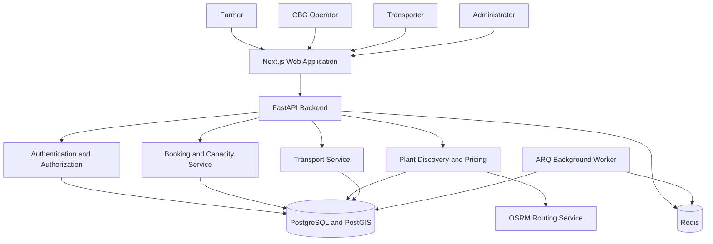
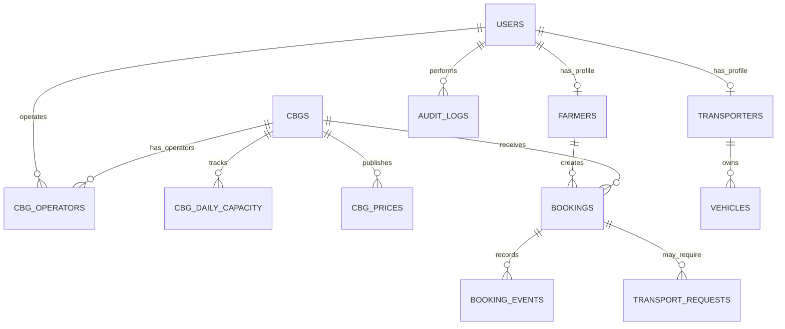
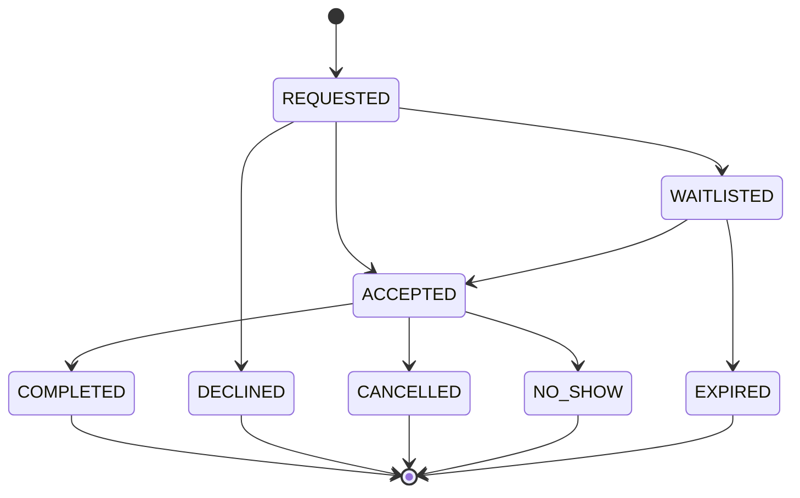

# System Architecture — Parali-to-CBG Marketplace

## 1. Purpose

The Parali-to-CBG Marketplace connects farmers who supply agricultural residue, such as paddy straw, with Compressed Biogas (CBG) plants that require biomass feedstock.

The system is designed to support plant discovery, price comparison, same-day booking, capacity management, delivery verification, and transporter coordination.

**Document status:** Proposed architecture. The database schema and local PostgreSQL/Redis infrastructure have been initialized. The application services and workflows described below are planned and must be implemented and tested before being treated as operational.

## 2. Technology Stack

### Backend

- Python 3.12
- FastAPI for HTTP APIs
- Pydantic v2 for request and response validation
- SQLAlchemy 2 async and asyncpg for database access
- PostgreSQL with PostGIS for persistent and geographic data
- Alembic for future versioned database migrations
- PyJWT for access and refresh tokens
- Argon2-based hashing for OTP-related secrets where appropriate
- Redis for rate limiting, caching, and background-job infrastructure
- ARQ for background jobs
- structlog for structured logging

### Frontend

- Next.js App Router and TypeScript
- Tailwind CSS and shadcn/ui
- TanStack Query for server-state management
- React Hook Form and Zod for form validation
- React Leaflet for map display
- OSRM for road-distance and route calculations
- next-intl for English, Hindi, and Punjabi

### Infrastructure and testing

- Docker Compose
- PostgreSQL with PostGIS
- Redis
- pytest and pytest-asyncio
- Playwright for end-to-end tests
- Ruff and mypy
- GitHub Actions for continuous integration

## 3. High-Level Architecture



The diagram represents the planned architecture, not a claim that every component is already implemented.

## 4. Main Components

### 4.1 Frontend

The frontend provides role-specific screens for farmers, CBG operators, transporters, and administrators.

It will handle form validation, display booking status, present plant recommendations on a map, and communicate with the backend through typed API requests.

Authentication tokens should be handled through secure, HTTP-only cookies and Next.js server-side route handlers. Sensitive tokens must not be stored in browser localStorage.

### 4.2 Backend API

FastAPI will expose endpoints for authentication, profiles, plant discovery, prices, bookings, transport, notifications, and administrative operations.

The backend is responsible for business rules, authorization, validation, database transactions, and audit logging. The frontend must not be trusted to enforce capacity or permissions on its own.

### 4.3 PostgreSQL and PostGIS

PostgreSQL is the source of truth for users, plants, prices, bookings, capacity, transport requests, and audit records.

PostGIS stores geographic points and supports efficient spatial filtering. A GiST index can reduce the number of nearby plants considered before road-distance calculations are performed.

Database constraints and transactions protect data integrity.

### 4.4 Redis and Background Worker

Redis will support rate limiting, caching, and job queues.

The background worker will perform scheduled tasks such as expiring undelivered bookings, releasing reservations, retrying notifications, and processing other time-dependent workflows.

Scheduled tasks must be idempotent so retrying a job does not apply the same business operation twice.

### 4.5 Routing Service

OSRM will estimate road distances, travel durations, and routes between a farmer's pickup location and candidate plants.

PostGIS straight-line proximity is a prefilter, not a substitute for road distance. If routing is unavailable, the system must communicate that reliable route estimates are unavailable rather than silently presenting straight-line distance as road distance.

## 5. Database Relationships

The principal entities and their intended relationships are shown below.



The diagram is conceptual. Exact cardinalities and foreign keys must be checked against the implemented schema and business rules.

### Main tables

- `users`: user identity, phone number, role, and account status.
- `farmers`: farmer-specific profile and pickup information.
- `cbgs`: plant details, geographic location, and verification status.
- `cbg_operators`: association between operators and plants.
- `cbg_daily_capacity`: daily capacity and reservation figures.
- `cbg_prices`: crop-specific prices and effective dates.
- `bookings`: booking details, status, reserved quantity, and locked price.
- `booking_events`: history of booking status transitions.
- `idempotency_keys`: support for safe retries of booking requests.
- `otp_requests`: OTP request metadata and verification controls.
- `refresh_tokens`: refresh-token lifecycle.
- `notifications`: notification delivery records.
- `transporters`, `vehicles`, and `transport_requests`: transport coordination.
- `payments_ledger`: financial calculations and receipt-related records.
- `audit_logs`: security-sensitive and administrative actions.
- `system_config`: configurable business settings.

## 6. Plant Discovery

The intended discovery workflow is:

1. Receive the farmer's pickup coordinates and requested crop and quantity.
2. Filter active, verified plants using PostGIS spatial queries.
3. Retrieve applicable plant prices and available capacity.
4. Request road-distance and duration estimates from OSRM.
5. Calculate estimated gross value using the requested quantity and displayed price.
6. Rank eligible plants by road distance and return up to five suitable recommendations where available.

Estimated gross value is not guaranteed final payment. Final settlement may depend on actual accepted weight, the locked price, and permitted deductions.

Plants without capacity may be shown as unavailable, but they must not be presented as bookable.

## 7. Booking Lifecycle



The final transition rules must be enforced by one backend service and checked against the booking status enum. Invalid transitions should return a conflict response and must not silently modify the booking.

Every transition should record the actor, previous state, new state, reason, and timestamp.

## 8. Concurrency-Safe Capacity Reservation

Capacity reservation is a critical correctness requirement.

The application must never rely on a separate read-then-write sequence to decide whether a booking fits. Two requests could otherwise read the same available capacity and both succeed.

The intended workflow is:

1. Validate the request, user permissions, plant status, date, quantity, and idempotency key.
2. Start a database transaction.
3. Atomically update the relevant plant/day capacity row using a conditional SQL update.
4. Allow the update only if the requested quantity fits the remaining allowed capacity.
5. If no row is updated, decline the request or apply the configured waitlist policy.
6. If capacity is reserved, insert the booking and its initial booking event in the same transaction.
7. Commit the transaction.
8. Return the persisted booking result.

If booking insertion fails, the transaction must roll back the reservation as well.

Conceptually, the capacity update follows this pattern:

```sql
UPDATE cbg_daily_capacity
SET reserved_today_tons = reserved_today_tons + :quantity
WHERE cbg_id = :cbg_id
  AND capacity_date = :booking_date
  AND is_closed = FALSE
  AND reserved_today_tons + :quantity <= :reservation_limit
RETURNING reserved_today_tons;
```

`:reservation_limit` represents the permitted limit calculated from the applicable business rules. It is a parameter placeholder, not a literal database column.

If the update returns no row, the reservation did not succeed. The implementation must handle this result inside the transaction and must never create an accepted booking without a successful reservation.

Cancellation, expiry, and other permitted release operations must also be transactional and idempotent.

## 9. Authentication and Authorization

- Verify phone ownership using OTP authentication.
- Hash OTP-related secrets, enforce expiry, limit attempts, and apply resend cooldowns.
- Issue short-lived access tokens and rotating refresh tokens.
- Validate token signatures, expiry, and expected algorithms.
- Derive identity and role from authenticated credentials, not request-body fields.
- Apply role-based authorization and object-level authorization to every protected resource.
- Restrict operators to their associated plants and farmers to their own bookings.
- Record sensitive administrative actions in audit logs.

Tests must cover unauthorized access, role escalation, cross-user access, OTP replay, and brute-force attempts.

## 10. Time and Scheduled Jobs

Business times use the `Asia/Kolkata` timezone. Database timestamps should be stored consistently in UTC, while local booking dates and deadlines must be interpreted using the business timezone.

The initial business rules specify a planned booking cutoff of 15:00 IST and a delivery deadline of 19:00 IST.

The worker must handle:

- Expiring accepted bookings that were not delivered by the deadline.
- Releasing capacity exactly once.
- Retrying notification delivery without duplicating booking changes.
- Recovering safely from worker restarts and repeated scheduled execution.

Boundary conditions at the cutoff and deadline must be explicitly tested.

## 11. Observability and Reliability

The application should provide:

- A health endpoint for service and dependency checks.
- Structured JSON logs.
- A request ID for tracing a request across components.
- Safe error responses without leaking secrets or internal stack traces.
- Database transaction boundaries for critical workflows.
- Retry and timeout policies for external routing and notification services.
- Metrics and load tests for booking latency and capacity correctness.

A health response should distinguish basic API availability from the readiness of required dependencies.

## 12. Testing Strategy

### Unit tests

Validate request rules, capacity calculations, price calculations, status transitions, and timezone handling.

### Integration tests

Use a real PostgreSQL/PostGIS database to test constraints, queries, transactions, and geographic filtering.

### Concurrency tests

Send many simultaneous booking requests against real PostgreSQL. For a test capacity of 50 tons, assert that accepted reservations never exceed 50 tons and that duplicate active bookings for the same farmer/day are rejected.

### Security tests

Check authentication, role permissions, object ownership, OTP limits, and idempotency behavior.

### End-to-end tests

Test the critical farmer booking, operator delivery-completion, and booking-expiry workflows using Playwright.

## 13. Current Implementation Status

Currently established:

- Docker Compose services for PostgreSQL/PostGIS and Redis.
- Initial SQL schema and default system configuration.
- Nine seeded CBG plant records.
- Business assumptions documented in `docs/ASSUMPTIONS.md`.
- Fresh-database schema initialization tested successfully.

Still to implement and verify:

- FastAPI application and service modules.
- Next.js application and authentication flow.
- Alembic migrations.
- Atomic booking and cancellation workflows.
- OSRM integration and caching.
- Background worker and scheduled jobs.
- Automated unit, integration, concurrency, security, and end-to-end tests.
- CI pipeline and actual load-test results.

This architecture is the implementation plan. Features should be marked complete only after code and relevant tests demonstrate that they work.